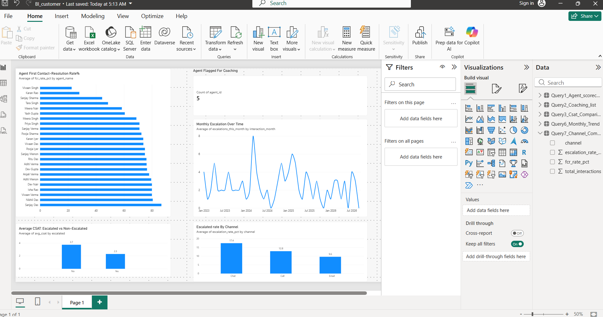

# Customer Escalation & Appointment Failure Analysis

**A SQL + Power BI project analyzing agent performance, escalations and appointment failures in a customer-operations (utility/telecom-style) contact centre.**

---

## Problem

Customer-operations teams lose time and customer goodwill in three places: appointments that fail or have to be rescheduled, interactions that get escalated instead of resolved on first contact, and quality issues that only show up in audits. Managers need one place to see which agents need coaching, which channels and appointment types are underperforming, and what is actually driving failures, so that coaching and process fixes go where they will have the most impact.

## Approach

I designed and built a relational database from scratch that mirrors a real contact-centre operation (appointment tracking, escalations, first-contact resolution, CSAT and quality audits), then analyzed it end to end:

- **Database design:** 5 connected tables (`customers`, `agents`, `appointments`, `interactions`, `quality_audits`) with foreign keys and `CHECK` constraints for valid statuses.
- **Data:** 400 customers, 25 agents, 650 appointments, 900 interactions and 280 quality audits (synthetic, generated to behave realistically).
- **Analysis:** 8 SQL queries using multi-table joins, CTEs, `CROSS JOIN` against team averages, `RANK()` and running-total window functions, and conditional aggregation.
- **Data quality:** Found and fixed an integer-division risk in the percentage calculations (explicit float cast), so rates are not silently truncated.
- **Visualization:** A 5-visual Power BI dashboard: FCR rate by agent, agents flagged for coaching, CSAT for escalated vs non-escalated interactions, monthly escalations over time, and escalation rate by channel.

## Key Insights

1. **Escalation hurts satisfaction badly.** Escalated interactions average a CSAT of **2.29**, against **3.72** for non-escalated ones, a gap of 1.43 points (about 38% lower).
2. **Five agents need coaching.** A coaching-priority query (agents below the team average on first-contact resolution and above it on escalation) flagged **5 of 25 agents** (AGT003, AGT009, AGT015, AGT016, AGT017). The same five sit at the bottom of the FCR chart on the dashboard.
3. **Chat is the weakest channel.** Chat escalates **17.4%** of the time, against 12.8% for calls and 9.6% for email, and it also has the lowest first-contact resolution (61.6% vs 71.8% for email). Chat has the fewest interactions (172 of 900), but the sample is large enough for the gap to be meaningful.
4. **Most appointment disruption is preventable.** Of the 250 appointments that failed or were rescheduled, the top two reasons were **customer not available (42)** and **incorrect address on file (40)**, together about one third (32.8%) of cases. Both can be addressed before the visit, with confirmation reminders and address checks at booking.
5. **One appointment segment stands out.** The overall appointment failure rate is **16.8%** (109 of 650). Meter Fault appointments in the Central Zone fail at **26.9%** (7 of 26), about 1.6x the overall rate. The group is small, so this is a hotspot to investigate, not a final conclusion.
6. **Audit findings point to soft skills and completeness.** 236 of 280 audits (84.3%) found an issue. The three most common were **tone/empathy in the response (58)**, **incomplete information given to the customer (52)** and **delayed response time (51)**, together 57.5% of all audits.
7. **No sustained trend in monthly escalations.** Escalations vary from month to month, with a peak around early 2024, but there is no clear long-term rise or fall. The final month in the data is partial, so I did not read anything into its drop.

## Impact

These are findings an operations or quality manager could act on directly:

- Target coaching at five named agents instead of the whole team.
- Review chat handling first (training, scripts, resolution tools), since it has both the highest escalation and the lowest first-contact resolution.
- Cut preventable appointment failures with day-before confirmations and address verification at booking.
- Focus quality training on tone/empathy, completeness of information and response time, which account for most audit findings.
- Prioritise escalation prevention, since each escalation costs roughly 1.4 CSAT points.

## Technical Skills Demonstrated

- Relational database design (foreign keys, constraints, realistic synthetic data)
- SQL: multi-table joins, CTEs, `CROSS JOIN` with team benchmarks, `RANK()`, running totals with `SUM() OVER`, `CASE WHEN` aggregation, `GROUP BY`, `DATE_FORMAT`
- Data quality: caught an integer-division issue and corrected it, then reconciled counts across queries (for example, failure reasons against appointment statuses)
- Power BI: multi-visual dashboard, aggregation types, date-hierarchy fixes, KPI cards and data labels
- Operations domain knowledge: FCR, escalation rate, CSAT, audit-based root cause analysis, appointment tracking

## Tech Stack

MySQL (schema, data, analysis queries) · Power BI Desktop (dashboard)

---

*All customer, agent and interaction data in this project is synthetically generated for demonstration purposes and does not represent real individuals or any real organisation.*
